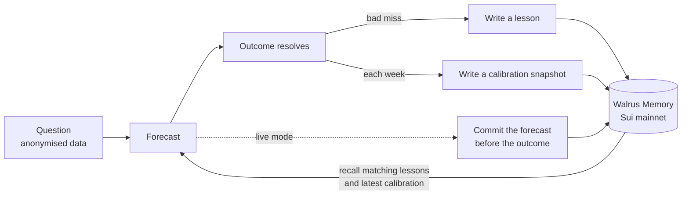

# Tuition

*The market charges tuition. Tuition keeps the notes.*

An AI crypto forecaster that writes lessons from its own mistakes to Walrus Memory on Sui mainnet, with a controlled memory ON vs OFF experiment that publishes the result whichever way it lands. Entry for the Total Recall hackathon (Tatum × Walrus), Track 1: Markets & Sports Prediction, and Best Walrus Memory.

<!-- GENERATED:headline -->
**Result (test split, 160 questions over 20 weeks):** Brier with memory OFF 0.271, ON 0.265. Change +0.0063, 95% CI [−0.0045, +0.0168], P(Δ>0) = 0.87. **Not statistically significant.**

Memory moved Brier 0.271 to 0.265, but the 95% interval spans zero, so this run does not show a reliable improvement.

Two identical no-memory passes differ by +0.0034 on the same questions, so a gap of this size can come from model noise alone.

Against a plain trailing base rate with no LLM, memory is −0.0053 (0.265 vs 0.259).

**Two official runs.** The first official run (`r-20261106-1001-f2a8`) had a bug: its memory arm asked for the newest calibration snapshot in a way that only searched the few closest matches, so from 2026-04-27 on it kept getting an old one (26 of 32 weeks stale; 6 of 32 snapshots ever reached a prompt). This run (`r-20261109-1519-27da`) is the single rerun, pre-registered before it started, with only that fixed (DECISIONS D51): 32 of 32 weeks got the newest snapshot. Both are published.

| Test split | Memory OFF | Memory ON | Δ | 95% CI | P(Δ>0) |
|---|---:|---:|---:|---:|---:|
| Rerun, calibration fixed (`r-20261109-1519-27da`, headline) | 0.271 | 0.265 | +0.0063 | [−0.0045, +0.0168] | 0.87 |
| First run, calibration frozen (`r-20261106-1001-f2a8`) | 0.267 | 0.258 | +0.0089 | [−0.0134, +0.0325] | 0.77 |
<!-- /GENERATED:headline -->

## Links

<!-- GENERATED:links -->
- Demo: https://tuition-jet.vercel.app
- Video: _to be added_
- Blog post: https://tuition-jet.vercel.app/blog
<!-- /GENERATED:links -->

## How memory is used



- **Lessons.** After a bad miss the agent writes a short post-mortem with the conditions it applies to. Before each forecast it recalls the lessons closest to the current market regime.
- **Calibration snapshots.** A summary of where its past forecasts ran high or low, recalled by every memory forecast.
- **Live commitments.** Each day's forecasts are written to Walrus before their 7-day outcomes are known, so they cannot be edited afterwards.

Walrus Memory is the system of record: the agent reads lessons back through `recall()`, not from local files.

## Why memory did not clearly help

Neither official run shows a reliable improvement. The data points to these reasons, none of which the experiment can prove on its own:

- **There is little to learn at this horizon.** Every arm scores close to a coin flip (0.25). On direction questions, all three LLM arms score 0.253 with or without memory.
- **The base rate wins.** A plain trailing base rate (0.259) beats every LLM arm on the test split, memory included (0.265), because the LLM arms lose on breakout questions.
- **The gain is small and uneven.** In the rerun, memory won 13 of 20 test weeks; drop the best two and the gain falls to +0.0012. By third of the run it was +0.0041, +0.0018 and +0.0086, which is not a learning curve.
- **Lessons moved forecasts a little.** In the rerun, forecasts that cited a lesson moved by about 0.04 on average and gained 0.013 on Brier; those citing none lost 0.0015. In the first run, with the frozen calibration snapshot, it was the other way round.

First run vs rerun, and the bug between them, are described in [docs/METHODOLOGY.md](docs/METHODOLOGY.md) and decision D51.

## Hackathon requirements

<!-- GENERATED:requirements -->
- [x] Walrus Memory writes on mainnet: **736** memories across all runs (175 lessons and 32 calibration snapshots in the official run)
- [x] At least 10 memories: **736**
- [x] Tatum RPC: the account object is read through Tatum's Sui gateway (`verify`, see `/verify`)
- [x] Tatum Data API: daily OHLCV candles for BTC, ETH, SOL, SUI
- [x] Blog post: https://tuition-jet.vercel.app/blog
<!-- /GENERATED:requirements -->

## Mainnet evidence

<!-- GENERATED:evidence -->
| Item | Value |
|---|---|
| Agent ID (`MEMWAL_AGENT_ID`) | `084487542e2bd6ec8eaf71edd877904d72858e4385b590514b993d40bc7c5907` |
| Account ID (`MEMWAL_ACCOUNT_ID`) | [`0x5c5969045495377ceb3ad60a5e6be9c240c5daca384f057c4845dbb4981a22ea`](https://suiscan.xyz/mainnet/object/0x5c5969045495377ceb3ad60a5e6be9c240c5daca384f057c4845dbb4981a22ea) |
| Official run | `r-20261109-1519-27da` |
| Lesson namespace | `tuition.r-20261109-1519-27da.lessons` (175) |
| Calibration namespace | `tuition.r-20261109-1519-27da.calibration` (32) |
| Live namespaces | `tuition.live.forecasts`, `tuition.live.lessons`, `tuition.live.calibration` |
| Memories by kind, all runs | lesson 557, calibration 106, smoke 1, forecast 72 (total 736) |
| Blob check (2026-11-10) | 299 of 299 blobs HTTP 200 from the aggregator |
| Recall round-trip | 3 of 3 lessons came back first by their own text |

Sample lesson blobs (the content is encrypted):

- [`jg8rwGuE5YYE3JJgyhliiKDxvHwyxMYjWcqAxUiwMM8`](https://aggregator.walrus-mainnet.walrus.space/v1/blobs/jg8rwGuE5YYE3JJgyhliiKDxvHwyxMYjWcqAxUiwMM8)
- [`x3yuaIUKK0k-JJcIThMX6BjCOKFDyIKjJARySJwCzWI`](https://aggregator.walrus-mainnet.walrus.space/v1/blobs/x3yuaIUKK0k-JJcIThMX6BjCOKFDyIKjJARySJwCzWI)
- [`SQ3Uiz_J_8QMsJvQ8AL7avYy5bDTELh4JlfT1IJSidQ`](https://aggregator.walrus-mainnet.walrus.space/v1/blobs/SQ3Uiz_J_8QMsJvQ8AL7avYy5bDTELh4JlfT1IJSidQ)
- [`tZ8LPCz4WZMPVAllWWbW9N6LSkqXuCkEF8XoXJVxeRo`](https://aggregator.walrus-mainnet.walrus.space/v1/blobs/tZ8LPCz4WZMPVAllWWbW9N6LSkqXuCkEF8XoXJVxeRo)
- [`7eo9gUamvz6Chzcq8R_U9baZer2wqKlrMq_I90j0lL8`](https://aggregator.walrus-mainnet.walrus.space/v1/blobs/7eo9gUamvz6Chzcq8R_U9baZer2wqKlrMq_I90j0lL8)
<!-- /GENERATED:evidence -->

Repeat these checks with `npm run engine -- verify --run <runId>`, or see the `/verify` page.

## Methodology

The same model answers the same 264 questions in strict weekly order, in four arms: a no-LLM base rate, memory OFF twice, and memory ON. The second OFF pass measures model noise. Tuning used only the dev split, under a rule fixed in advance, and the headline is the test split of the official rerun (D51), with the first official run published beside it. The interval is a paired block bootstrap by decision week. Full detail is in [docs/METHODOLOGY.md](docs/METHODOLOGY.md), and every deviation from the plan is in [docs/DECISIONS.md](docs/DECISIONS.md).

**Leakage controls.** Prompts contain no tickers, dates, volumes or absolute prices. Each run starts with empty namespaces, and a lesson is written only when the simulated clock reaches its outcome.

**Limitations.**

- Small sample: 160 test questions over 20 weeks, on four correlated crypto assets.
- Crypto only, and one 7-day horizon.
- No `temperature` setting is sent, because the models reject it (DECISIONS D17), so the LLM is not deterministic: identical passes score differently.
- Only 37% of breakout questions resolved yes (49 of 132, DECISIONS D20), not the half the threshold rule aims for, because the replay period was calmer than the 180 days behind it. The forecast prompt tells the model that breakout thresholds are set so YES happens "roughly half the time historically". That may be one reason every LLM arm scored worse than the plain base rate on breakout questions. The prompt was left as it was, so the runs stay comparable.
- The managed relayer sees memory text in plaintext when it embeds it. Stored blobs are encrypted.
- The model may still recognise a market from its shape.
- Scheduled live forecasts usually commit around 06:00 to 07:00 UTC, some hours into their first day.
- One tuning mistake is on record (D42): a run was resumed without its week limit and forecast some test weeks with no memory arm. It was stopped, never scored, and guards were added.

## Setup and reproduce

Requires Node 24.22.1+ (or 22.23.4+).

```bash
npm install
cp .env.example .env        # the four secrets; everything else has defaults
npm test                    # no keys needed

# Phase 0 probes save raw responses to engine/fixtures/
npm run probe:node
npm run smoke:memwal
npm run probe:ohlcv
npm run probe:sui
npm run probe:aggregator
npm run probe:llm

# The experiment
npm run engine -- replay --official
npm run engine -- score --run <runId>
npm run engine -- export --run <runId>          # add --docs to refill this README and the blog table
npm run engine -- verify --run <runId>
npm run engine -- memories --run <runId>

npm run dev                 # the site, from web/public/data
```

Both official runs ran in GitHub Actions (`.github/workflows/official.yml`). The workflow allows one official run plus one pre-registered rerun of it (D51), and refuses anything more. Models: forecasts `claude-haiku-5.5`, reflection `claude-sonnet-5.5`, both through the Orbio gateway (D16). Their checkpoints and ledgers are committed in `engine/state/`, so `score`, `export` and the site reproduce the published numbers without keys. A new replay uses a new namespace, and LLM sampling noise means its numbers will differ slightly.
