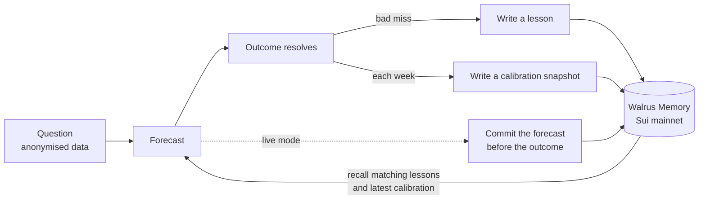

# Tuition

*The market charges tuition. Tuition keeps the notes.*

An AI crypto forecaster that writes lessons from its own mistakes to Walrus Memory on Sui mainnet, with a controlled memory ON vs OFF experiment that publishes the result whichever way it lands. Entry for the Total Recall hackathon (Tatum × Walrus), Track 1: Markets & Sports Prediction, and Best Walrus Memory.

<!-- GENERATED:headline -->
**Result (test split, 160 questions over 20 weeks):** Brier with memory OFF 0.267, ON 0.258. Change +0.0089, 95% CI [−0.0134, +0.0325], P(Δ>0) = 0.77. **Not statistically significant.**

Memory moved Brier 0.267 to 0.258, but the 95% interval spans zero, so this run does not show a reliable improvement.

Two identical no-memory passes differ by +0.0052 on the same questions, so a gap of this size can come from model noise alone.

Against a plain trailing base rate with no LLM, memory is +0.0010 (0.258 vs 0.259).
<!-- /GENERATED:headline -->

## Links

<!-- GENERATED:links -->
- Demo: _to be added_
- Video: _to be added_
- Blog post: _to be added_
<!-- /GENERATED:links -->

## How memory is used



- **Lessons.** After a bad miss the agent writes a short post-mortem with the conditions it applies to. Before each forecast it recalls the lessons closest to the current market regime.
- **Calibration snapshots.** A summary of where its past forecasts ran high or low, recalled by every memory forecast.
- **Live commitments.** Each day's forecasts are written to Walrus before their 7-day outcomes are known, so they cannot be edited afterwards.

Walrus Memory is the system of record: the agent reads lessons back through `recall()`, not from local files.

## Why memory did not clearly help

The official run does not show a reliable improvement. The data points to these reasons, none of which the experiment can prove on its own:

- **There is little to learn at this horizon.** Every arm scores close to a coin flip (0.25). On direction questions, all LLM arms score the same with or without memory.
- **Lessons barely moved forecasts.** Across all 33 weeks, a forecast that cited a lesson moved by about 0.04 on average.
- **Cited lessons do not explain the gain.** Across all 33 weeks, forecasts that cited a lesson scored slightly worse than without memory, while those citing none scored better. On the test split, the gap sits in breakout questions. Every memory forecast also sees the calibration snapshot, so calibration may be doing more than the lessons, but this run cannot separate the two.

## Hackathon requirements

<!-- GENERATED:requirements -->
- [x] Walrus Memory writes on mainnet: **485** memories across all runs (181 lessons and 32 calibration snapshots in the official run)
- [x] At least 10 memories: **485**
- [x] Tatum RPC: the account object is read through Tatum's Sui gateway (`verify`, see `/verify`)
- [x] Tatum Data API: daily OHLCV candles for BTC, ETH, SOL, SUI
- [ ] Blog post: link to be added on publication
<!-- /GENERATED:requirements -->

## Mainnet evidence

<!-- GENERATED:evidence -->
| Item | Value |
|---|---|
| Agent ID (`MEMWAL_AGENT_ID`) | `084487542e2bd6ec8eaf71edd877904d72858e4385b590514b993d40bc7c5907` |
| Account ID (`MEMWAL_ACCOUNT_ID`) | [`0x5c5969045495377ceb3ad60a5e6be9c240c5daca384f057c4845dbb4981a22ea`](https://suiscan.xyz/mainnet/object/0x5c5969045495377ceb3ad60a5e6be9c240c5daca384f057c4845dbb4981a22ea) |
| Official run | `r-20261106-1001-f2a8` |
| Lesson namespace | `tuition.r-20261106-1001-f2a8.lessons` (181) |
| Calibration namespace | `tuition.r-20261106-1001-f2a8.calibration` (32) |
| Live namespaces | `tuition.live.forecasts`, `tuition.live.lessons`, `tuition.live.calibration` |
| Memories by kind, all runs | lesson 364, calibration 72, smoke 1, forecast 48 (total 485) |
| Blob check (2026-11-06) | 261 of 261 blobs HTTP 200 from the aggregator |
| Recall round-trip | 3 of 3 lessons came back first by their own text |

Sample lesson blobs (the content is encrypted):

- [`ACiAz83QGKbHdy3LfsTv9QgiSm_bUfINuy8kpuI8QUo`](https://aggregator.walrus-mainnet.walrus.space/v1/blobs/ACiAz83QGKbHdy3LfsTv9QgiSm_bUfINuy8kpuI8QUo)
- [`pRy2OGlZo669OufMMptNXGpezzFRExX7yxUjJ2s-2nM`](https://aggregator.walrus-mainnet.walrus.space/v1/blobs/pRy2OGlZo669OufMMptNXGpezzFRExX7yxUjJ2s-2nM)
- [`iABwn1-HE6IhXSMuNDNqnEJ-Sl0vA8Un_uvWePplsMw`](https://aggregator.walrus-mainnet.walrus.space/v1/blobs/iABwn1-HE6IhXSMuNDNqnEJ-Sl0vA8Un_uvWePplsMw)
- [`jSTYfE6PUynJPOG9tPMOZ2WHQV12C5iomdtRoV_gCT4`](https://aggregator.walrus-mainnet.walrus.space/v1/blobs/jSTYfE6PUynJPOG9tPMOZ2WHQV12C5iomdtRoV_gCT4)
- [`K3Ghwv3oYVYN5hUj_-JNcULmJp49hOnktsKs7rBx9yg`](https://aggregator.walrus-mainnet.walrus.space/v1/blobs/K3Ghwv3oYVYN5hUj_-JNcULmJp49hOnktsKs7rBx9yg)
<!-- /GENERATED:evidence -->

Repeat these checks with `npm run engine -- verify --run <runId>`, or see the `/verify` page.

## Methodology

The same model answers the same 264 questions in strict weekly order, in four arms: a no-LLM base rate, memory OFF twice, and memory ON. The second OFF pass measures model noise. Tuning used only the dev split, under a rule fixed in advance, and the headline is the test split of a single official run. The interval is a paired block bootstrap by decision week. Full detail is in [docs/METHODOLOGY.md](docs/METHODOLOGY.md), and every deviation from the plan is in [docs/DECISIONS.md](docs/DECISIONS.md).

**Leakage controls.** Prompts contain no tickers, dates, volumes or absolute prices. Each run starts with empty namespaces, and a lesson is written only when the simulated clock reaches its outcome.

**Limitations.**

- Small sample: 160 test questions over 20 weeks, on four correlated crypto assets.
- Crypto only, and one 7-day horizon.
- The LLM is not deterministic even at temperature 0.
- The managed relayer sees memory text in plaintext when it embeds it. Stored blobs are encrypted.
- The model may still recognise a market from its shape.
- Scheduled live forecasts usually commit around 06:00 to 07:00 UTC, some hours into their first day.
- One tuning mistake is on record (D42): a run was resumed without its week limit and forecast some test weeks with no memory arm. It was stopped, never scored, and guards were added.

## Setup and reproduce

Requires Node 24.22.1+ (or 22.23.4+).

```bash
npm install
cp .env.example .env        # the four secrets; everything else has defaults
npm test                    # no keys needed

# Phase 0 probes save raw responses to engine/fixtures/
npm run probe:node
npm run smoke:memwal
npm run probe:ohlcv
npm run probe:sui
npm run probe:aggregator
npm run probe:llm

# The experiment
npm run engine -- replay --official
npm run engine -- score --run <runId>
npm run engine -- export --run <runId>          # add --docs to refill this README and the blog table
npm run engine -- verify --run <runId>
npm run engine -- memories --run <runId>

npm run dev                 # the site, from web/public/data
```

The official run ran in GitHub Actions (`.github/workflows/official.yml`), which refuses to start a second one. Its checkpoint and ledger are committed in `engine/state/`, so `score`, `export` and the site reproduce the published numbers without keys. A new replay uses a new namespace, and LLM sampling noise means its numbers will differ slightly.
